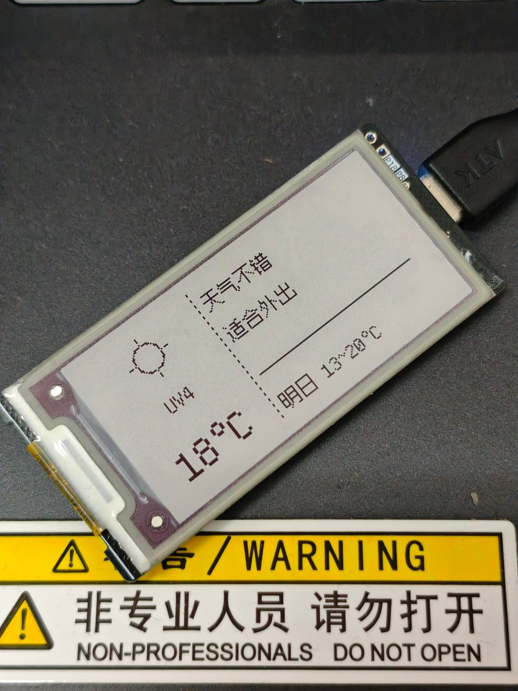

# EPD-ESP-Driver

把一块**超市淘汰的电子价签**改造成**桌面天气摆件**。



> 上图是改造后的实物：正在显示 `18°C / UV4 / 天气不错 / 适合外出 / 明日 13~20°C`。
> 屏幕下方那张黄黑警示贴是旁边设备上的，与本项目无关。

---

## 一、这块屏幕是什么

### 1.1 来历

一块**超市淘汰的电子价签（ESL）**。

外壳和主板上**没有任何品牌信息**——没有 LOGO，没有型号铭牌，只有几行丝印。
典型的白牌/代工货，网上搜不到任何成品资料。

它原本贴在货架上显示商品价格，靠纽扣电池供电，几个月才刷新一次。
超市升级系统后整批淘汰，流到二手市场。

### 1.2 型号怎么查出来的

**唯一线索是屏幕背面的一行丝印**：

```
SE2213JS0C1    SPP0FW1    H00B350BYB    24116-00321
```

拿 `SE2213JS0C1` 去搜，命中 **Pervasive Displays（PDI，元太旗下）** 的产品线——
去掉模组批次前缀 `S`，实际型号是 **`E2213JS0C1`**，
一颗标准的 2.13 英寸三色 EPD。

再顺着型号找到 PDI 官方规格书（`1P227-00 Rev 02`），
才拿到了**完整的信号定义**：

- [PDI 官方规格书（Mouser 镜像）](https://www.mouser.com/catalog/specsheets/Pervasive%20Displays-02-17-2021-1P227-00_02_E2213JS0C1,%20E2213JS0C2_20210204.pdf)
- [DigiKey 产品页](https://www.digikey.com/en/products/detail/pervasive-displays/E2213JS0C1/13572392)

**这就是这块无牌价签能被驱动起来的关键**：
丝印认出屏幕 → 规格书拿到时序和引脚 → 才能写出驱动。

> 另外板上那颗 ESP32-S3 模块的屏蔽罩上印着 FCC ID `2AD6X-ESPS3N8R2`，
> 也是靠这个编号确认了主控型号和引脚能力。

### 1.3 屏幕规格

| 项 | 参数 |
|---|---|
| 型号 | **Pervasive Displays E2213JS0C1**（背面丝印 `SE2213JS0C1`） |
| 尺寸 | **2.13 英寸**（对角线 54.1 mm） |
| 分辨率 | **212 × 104**，111 dpi |
| 颜色 | **黑 / 白 / 红** 三色（E Ink Spectra Red R2.0） |
| 有效显示区 | 48.55 × 23.71 mm |
| 外形尺寸 | 59.2 × 29.2 × 0.9 mm，约 3.3 g |
| 接口 | **SPI**，40 pin FPC（带驱动板总成） |
| 驱动方式 | **iTC**（内置时序控制器，MCU 直接发数据即可） |
| 工作电压 | 2.3–3.6 V（3.0 V 典型，兼容 3.3 V） |
| 工作温度 | **0 ~ +40 °C** |
| 特性 | **双稳态**——断电后画面永久保留，零功耗 |

### 1.4 主控与板子

价签主板是**为一次性产品定制的**，不是标准开发板：

| 项 | 说明 |
|---|---|
| 主控模块 | **ESP32-S3-N8R2**（8MB Flash / 2MB PSRAM，带电磁屏蔽罩） |
| 认证编号 | FCC ID `2AD6X-ESPS3N8R2`、IC `29018-ESPS3N8R2`、CMIT `2022DP2107` |
| 引出方式 | **28 个邮票孔**，非标准间距布局 |
| 按钮 | **没有 BOOT / RST 键**，只有背面一个无标记按钮（推测刷新/检测） |
| 供电 | USB Type-C（原为电池供电） |

> ⚠️ **没有 BOOT/RST 按钮**是个真实的坑：
> 烧录时若进不去下载模式，只能手动短接 GPIO0 到 GND 再上电。

---

## 二、为什么做成天气摆件

### 2.1 刷新率决定了它的定位

三色 EPD 的刷新是**硬件级慢**——一次全刷要 **15~20 秒**，
期间屏幕会黑白红反复闪烁。

这是 E Ink Spectra 三色膜的物理特性，**不是驱动没写好，刷不快**。

所以它天生不适合任何"动"的场景：看视频、刷网页、做秒级时钟，全都不现实。

但它有两个别的方案比不了的优点：

| 优点 | 含义 |
|---|---|
| **双稳态** | 断电后画面**永久保留**，显示屏本身不耗电 |
| **纸质感** | 反射式，靠环境光，不刺眼，长时间看不累 |

**结论：低频更新 + 常驻显示 + 纸质感 = 桌面信息牌的理想形态。**

### 2.2 所以做了天气摆件

天气信息**一天变几次就够了**，恰好匹配这个刷新节奏：

- 早上出门前同步一次，看一眼穿什么
- 一天刷 2~4 次，每次 15 秒，完全无感
- 平时断电也一直显示着，就是个静态摆件

**2.13 寸这个尺寸也刚好**：放桌角、显示器边上不占地方，
212×104 的分辨率足够塞下"温度 + 天气图标 + 一句中文建议"。

### 2.3 当前实现


```
┌────────────────┬─────────────────────────────┐
│                │                    ┌───────┐│ ← 黑底圆角阴刻
│    ☀ 图标      │  天气不错           │15:20  ││   最新更新时间
│                │  适合外出           └───────┘│
│   UV4          │                             │
│                │  ─────────────────          │
│   18°C         │  明日 13~20°C               │
│   13~20°C      │                             │
└────────────────┴─────────────────────────────┘
   左栏 80px          右栏 132px
```

**几个设计取舍：**

| 元素 | 做法 | 为什么 |
|---|---|---|
| **当前温度** | 24px（12px×2 整数倍放大） | 一眼能读，像素边缘依然锐利 |
| **今日温度区间** | 12px 紧跟下方，`13~20°C` | 次要信息降一档，不抢主视觉 |
| **最高温染红** | 只把「20」画成红色 | 红色是这块屏唯一的强调色，留给最该注意的数 |
| **更新时间** | 10px + 黑底圆角 **阴刻**（挖白字） | 比正文小一档，不干扰阅读；黑底保证小字可读 |
| **时间格式** | `HH:MM`，24 小时制 | 5 个字符仅占 25px 宽 |

> 「阴刻」= 先铺黑色圆角矩形，再用「擦除」把数字挖成白色。
> 三色 EPD 上就是黑底白字，比白底黑字在这种小字号下更清楚。

设计上刻意**只放最有用的信息**：
左边一眼看到温度和当天区间，右边一句人话建议，
右上角小字标明数据是什么时候的——避免看着昨天数据做今天的决定。

**后续方向**：加上农历/日程后可以变成**桌面日历摆件**，
同样受益于"低频更新"这个特性。

---

## 三、数据怎么进去

天气**不走 ESP32 的 WiFi**——它只有 2.4GHz，而现在路由器多是 5GHz，
经常根本连不上。改成让手机或电脑取好天气，再通过**蓝牙**写进来：

```
Open-Meteo (HTTP) ──> 电脑服务 / 手机网页
                            │
                            └── BLE 写入 JSON ──> ESP32 ──> 墨水屏
```

ESP32 端只做两件事：**收数据**、**刷屏**。
不联网、不做 HTTP、不需要 NTP。

---

## 四、硬件接线

### 4.1 信号脚定义（来自 PDI 官方规格书）

屏端 FPC 标准定义（24 脚版本，本项目模组是 40 脚总成）：

| Pin | 信号 | 说明 |
|---|---|---|
| 9 | **BUSY_N** | 忙信号（低 = 正在刷新） |
| 10 | **RST_N** | 复位（低有效） |
| 11 | **D/C** | 数据 / 命令选择 |
| 12 | **CSB** | 片选（低有效） |
| 13 | **SCL** | SPI 时钟 |
| 14 | **SDA** | SPI 数据（MCU → 屏） |
| 8 | BS | SPI 模式（接 GND = 4 线 SPI） |
| 16 / 15 | VDD / VDDIO | 供电（3.0~3.3 V） |
| 17 | GND | 地 |
| 2,3,5,18,20-24 | GDR/RESE/VDHR/VDDD/VDH… | 驱动电压，各接电容 |

板子把这几个信号单独引出并标了丝印：
`SCLK / SDI / D-C / CS / BUSY / RST`。

### 4.2 GPIO 映射（本项目使用）

| 信号 | GPIO |
|---|---|
| SCLK | **12** |
| SDI (MOSI) | **11** |
| CS | **10** |
| D/C | **13** |
| BUSY | **15** |
| RST | **14** |

> 这组映射是**逆向出来的**：
> 功能脚连的那批 GPIO 与邮票孔编号脚**不是同一批**，无法从板上直接读出。
> 当前固件在实物上跑通、画面正常（见文首照片），视为已验证。
> 换板子的话需要用通断档或扫描程序重新确认。

引脚定义在 `firmware/20_epd_weather_station/20_epd_weather_station.ino`
顶部，可直接改。

---

## 五、烧录固件

### 5.1 环境

**Arduino IDE**（本项目在 2.3.9 + Arduino-ESP32 core **3.3.x** 上验证）

板卡设置**必须**这样选：

```
Board            : ESP32S3 Dev Module      ← 不能选 ESP32 Dev Module
FlashSize        : 16MB
PartitionScheme  : Huge APP (3MB No OTA/1MB SPIFFS)
USB CDC On Boot  : Enabled                 ← 否则串口没输出
```

> **分区方案不能省**：默认 4MB 方案固件会占到 **96%** 顶死；
> 改成 Huge APP 后降到 **40%**。

### 5.2 编译

把 `firmware/20_epd_weather_station/` 整个目录作为 sketch 打开
（.ino 与文件夹同名）。

命令行等价写法：

```powershell
arduino-cli compile `
  --fqbn "esp32:esp32:esp32s3:PSRAM=disabled,FlashSize=16M,PartitionScheme=huge_app" `
  firmware/20_epd_weather_station
```

实测：**1,290,581 B（41%）/ RAM 17%**

### 5.3 首次上电

串口（115200）应看到：

```
=== EPD 天气站 v3 (BLE) ===
[EPD] 初始化...
[BLE] 广播中，设备名: EPD-Weather
```

---

## 六、部署同步服务（电脑端，推荐）

装好后**开机自动运行**，不用管。

```powershell
cd service

# 1. 独立虚拟环境
python -m venv .venv
.\.venv\Scripts\python.exe -m pip install bleak httpx `
  -i https://pypi.tuna.tsinghua.edu.cn/simple

# 2. 安装（会先试跑一次验证链路）
.\install_task.ps1 -City 杭州
```

| 命令 | 作用 |
|---|---|
| `.\install_task.ps1 -City 杭州` | 安装并指定城市 |
| `.\install_task.ps1 -Status` | 看状态、内存占用、最近日志 |
| `.\install_task.ps1 -Uninstall` | 卸载 |

改城市：编辑 `service/config.json` 的 `city`，然后重启任务。

> **为什么是「计划任务」而不是「Windows 服务」**：
> BLE 在 Windows 上走 WinRT，需要用户会话；
> SYSTEM 服务跑在 Session 0，枚举不到蓝牙设备。
> 详见 [`service/README.md`](service/README.md)。

### 手机端（可选）

不方便常开电脑时，可用 [EPD-BLE-SYNC](https://github.com/ABE9-mix/EPD-BLE-SYNC)
里的 Web Bluetooth 网页，手机 Chrome 打开即用。

| | 电脑服务 | 手机网页 |
|---|---|---|
| 自动同步 | ✅ 开机常驻 | ⚠️ 页面要保持后台 |
| iOS | — | ❌ 不支持 Web Bluetooth |
| 城市配置 | `service/config.json` | 页面输入框 |

**两处城市各存各的，互不影响。**

---

## 七、BLE 协议

采用 **Nordic UART Service (NUS)**，
nRF Connect 等通用 App 也能直接连。

| 用途 | UUID |
|---|---|
| Service | `6e400001-b5a3-f393-e0a9-e50e24dcca9e` |
| RX（主机 → ESP32） | `6e400002-b5a3-f393-e0a9-e50e24dcca9e` |
| TX（ESP32 → 主机） | `6e400003-b5a3-f393-e0a9-e50e24dcca9e` |

负载：UTF-8 JSON，**以 `\n` 结尾**，字段全部可选（缺省保留原值）。

```json
{
  "temp": 18, "uv": 4, "code": 113,
  "a1": "天气不错", "a2": "适合外出",
  "fc_low": 13, "fc_high": 20,
  "epoch": 1730544000
}
```

| 字段 | 说明 |
|---|---|
| `temp` / `uv` | 左栏显示（`°C` 由固件补） |
| `code` | 天气图标代码；不发则由 `desc` 反推 |
| `a1` / `a2` | **右栏中文建议**，每行 ≤10 个汉字 |
| `fc_low` / `fc_high` | 明日温度 → 「明日 13~20°C」 |
| `epoch` | 主机时间戳，用于校准设备时钟 |

| 指令 | 说明 |
|---|---|
| `{"cmd":"status"}` | 查询状态，TX 回 `{"ok":true,"last":"22:48",...}` |
| — | 刷屏完成后 ESP32 主动 notify `{"ok":true,"msg":"displayed"}` |

---

## 八、中文字库是怎么来的

ESP32 读不到系统字体，中文必须**预先点阵化烧进固件**。

```
service/advice.py  ← 文案表的唯一真相来源
        ├─→ 决定屏幕说什么话
        └─→ tools/gen_font.py 生成字库时 import 它
```

**字库和文案永远不会脱节，不会出现方框。**
134 个字（含英文数字）只占 **3.2 KB**。

字体是**方舟像素**（Ark Pixel Font，SIL OFL-1.1），
真点阵、无抗锯齿，正好配墨水屏。共两套：

| 字库 | 字号 | 内容 | 用途 |
|---|---|---|---|
| `font_zh12.h` | 12px | 134 字（中英数字符号） | 正文、温度、建议 |
| `font_time10.h` | 10px | 11 字（0-9 与冒号） | 右上角时间戳，仅 220 字节 |

### 改文案

```powershell
# 1. 编辑 service/advice.py 的 PHRASES
# 2. 重新生成字库（直接写进固件目录）
python tools/gen_font.py
# 3. 检查有没有缺字方框
python tools/check_tofu.py
# 4. 重新烧录固件
```

> ⚠️ **方舟像素 12px 的 zh_hans 子集并不覆盖所有汉字**。
> 例如「即」在该字体里是空心方框，所以文案用「正在下雨」而不是「即将下雨」。
> **改完文案务必跑 `check_tofu.py`。**

---

## 九、无硬件预览与测试

```powershell
# 渲染整屏效果（复刻固件绘制逻辑，看到的就是屏上效果）
python tools/preview_scene.py            # 输出 preview/preview_scene.png

# 字库逐点打印，确认字形
python tools/preview_font.py "正在下雨" "记得带伞"

# 离线测试：建议逻辑、字表覆盖、载荷大小（30 项）
python tools/test_advice.py
```

---

## 十、排查

| 现象 | 原因 / 处理 |
|---|---|
| 串口无输出 | `USB CDC On Boot` 没开 |
| 编译超 flash | 分区方案没选 **Huge APP** |
| 烧录进不去下载模式 | 本板无 BOOT 键，短接 GPIO0→GND 再上电 |
| 上传报 `This chip is ESP32-S3, not ESP32` | 板型选错，必须 `ESP32S3 Dev Module` |
| 搜不到 `EPD-Weather` | ①没上电 ②被手机连着 ③固件崩溃重启中 |
| 画面全白/全黑、BUSY 永不高 | 优先怀疑 GPIO 映射（见 §4.2） |
| 中文显示方框 | 文案含字库缺失的字 → 跑 `check_tofu.py` |
| 刷新很慢/闪 | **正常**，三色全刷 15~20 秒是硬件特性 |
| 时间差 8 小时 | 固件已修（`TZ=CST-8`） |
| 服务不跑 | `service\install_task.ps1 -Status` 看状态 |

日志：`service/logs/epd-sync.log`

---

## 十一、目录结构

```
EPD-ESP-Driver/
├─ firmware/20_epd_weather_station/   # Arduino 工程
│   ├─ 20_epd_weather_station.ino     # 主程序（引脚定义在顶部）
│   ├─ eink_weather.{h,cpp}           # BLE 服务 + 广播看门狗
│   ├─ epd_layout.{h,cpp}             # 双栏布局 + 字库渲染
│   ├─ font_zh12.h                    # 12px 中文点阵（gen_font.py 生成）
│   ├─ font_time10.h                  # 10px 时间数字（gen_font.py 生成）
│   └─ web_pages.h                    # WiFi 配置页（可选功能）
├─ service/                           # 电脑端同步服务
│   ├─ epd_sync.py                    # 主程序
│   ├─ advice.py                      # 中文建议逻辑 + 字表
│   ├─ install_task.ps1               # 安装/卸载/状态
│   └─ README.md                      # 服务部署细节
├─ tools/                             # 字库与测试工具
├─ assets/ark12/                      # 方舟像素字体（OFL-1.1）
└─ docs/                              # 实物照片、预览图、改造记录
```

---

## 十二、已知限制

- **无 BOOT/RST 按钮**：烧录掉线时需手动短接 GPIO0
- **刷新 15~20 秒**：三色 EPD 物理特性，不适合任何动态内容
- **工作温度 0~40°C**：冬天放室外可能显示异常
- **WiFi 配置页**（`web_pages.h`）需要 2.4GHz，属可选功能，主路径是蓝牙
- 手机 Web Bluetooth **iOS 全系不支持**
- GPIO 映射来自逆向，换板子需重新确认

---

## 十三、许可

- 界面字体 **[方舟像素字体 / Ark Pixel Font](https://github.com/TakWolf/ark-pixel-font)**
  — SIL Open Font License 1.1，全文见 [`assets/ark12/OFL.txt`](assets/ark12/OFL.txt)
- 屏幕规格引用自 Pervasive Displays 公开规格书，版权归其所有
