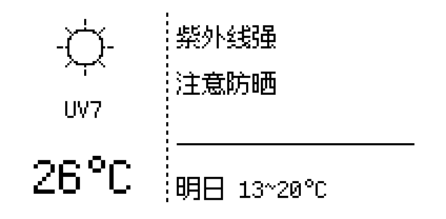

# EPD-ESP-Driver

ESP32-S3 驱动 **2.13" 三色墨水屏**（212×104）做天气站：**BLE 传数据 + 方舟像素 12px 双栏中文界面**。

天气不走 ESP32 的 WiFi——手机或电脑取好天气后通过蓝牙写进去，
所以不受「ESP32 只有 2.4GHz、家里路由器是 5GHz」的限制。



```
┌────────────────┬─────────────────────────────┐
│                │  紫外线强                    │  ← 中文建议（第 1 句）
│    ☀ 图标      │  注意防晒                    │  ← 中文建议（第 2 句）
│                │  ─────────────────          │
│   UV7          │  明日 13~20°C                │  ← 明日预告
│   26°C         │                              │
└────────────────┴─────────────────────────────┘
   左栏 80px          右栏 132px
```

---

## 一、这套东西由三部分组成

| 部分 | 目录 | 作用 |
|---|---|---|
| **固件** | `firmware/20_epd_weather_station/` | ESP32 端：驱动墨水屏 + BLE 收数据 |
| **同步服务** | `service/` | 电脑端：定时取天气 → BLE 写入 |
| **工具链** | `tools/` | 生成中文字库、无硬件预览、离线测试 |

数据流：

```
Open-Meteo ──HTTP──> 电脑服务 / 手机网页
                          │
                          └──BLE 写入 JSON──> ESP32 ──> 墨水屏
```

---

## 二、硬件

| 部件 | 型号 |
|---|---|
| 主控 | ESP32-S3（本项目用 **ESP32-S3-N8R2** 模块） |
| 屏幕 | PDI / 微雪 **2.13" 三色（黑/白/红）墨水屏**，212×104 |
| 连接 | 6 根信号线：SCLK / SDI(MOSI) / D-C / CS / BUSY / RST |

### 引脚（`20_epd_weather_station.ino` 顶部可改）

| 功能 | GPIO |
|---|---|
| CS | 10 |
| DC | 13 |
| RST | 14 |
| BUSY | 15 |
| MOSI (SDI) | 11 |
| SCLK | 12 |

> ⚠️ 这是**某块具体板子逆向出来的接线**，不一定适用于你的板。
> 换板子后用 `13_epd_gpio_scan` 的思路重新确认引脚。

---

## 三、烧录固件

### 1. 环境

**Arduino IDE**（本项目在 2.3.9 上验证）+ Arduino-ESP32 core **3.3.x**

板卡设置**必须**用：

```
Board            : ESP32S3 Dev Module
FlashSize        : 16MB
PartitionScheme  : Huge APP (3MB No OTA/1MB SPIFFS)
PSRAM            : Disabled（视板子而定）
USB CDC On Boot  : Enabled（否则串口没输出）
```

> 分区方案不能省略：默认 4MB 方案固件会占到 **96%**，改成 Huge APP 后降到 **40%**。
>
> 注意 `FlashSize` 按你板子的实际容量选；本项目实测用的是 16MB 版本配置。

### 2. 编译

把 `firmware/20_epd_weather_station/` 整个目录作为 sketch 打开（.ino 同名文件夹）。

命令行等价写法：

```powershell
arduino-cli compile `
  --fqbn "esp32:esp32:esp32s3:PSRAM=disabled,FlashSize=16M,PartitionScheme=huge_app" `
  firmware/20_epd_weather_station
```

实测占用：**1,289,717 B（40%）/ RAM 17%**

### 3. 首次上电

烧完串口应看到：

```
=== EPD 天气站 v3 (BLE) ===
[EPD] 初始化...
[BLE] 广播中，设备名: EPD-Weather
```

---

## 四、部署同步服务（电脑端，推荐）

装好后**开机自动运行**，不用管。

```powershell
cd service

# 1. 建独立虚拟环境
python -m venv .venv
.\.venv\Scripts\python.exe -m pip install bleak httpx `
  -i https://pypi.tuna.tsinghua.edu.cn/simple

# 2. 安装（会先试跑一次验证链路）
.\install_task.ps1 -City 杭州
```

| 命令 | 作用 |
|---|---|
| `.\install_task.ps1 -City 杭州` | 安装并指定城市 |
| `.\install_task.ps1 -Status` | 看状态、内存占用、最近日志 |
| `.\install_task.ps1 -Uninstall` | 卸载 |

**城市配置**：改 `service/config.json` 的 `city`，然后
`Stop-ScheduledTask EPD-Weather-Sync; Start-ScheduledTask EPD-Weather-Sync`

### 为什么是「计划任务」而不是「Windows 服务」

BLE 在 Windows 上走 WinRT（`Windows.Devices.Bluetooth`），**需要用户会话**。
SYSTEM 服务跑在 Session 0，枚举不到蓝牙设备，扫描直接失败。
所以用「登录时启动的隐藏任务」——效果一样，但没有窗口、不用管。

> 这也意味着：**必须先登录 Windows 它才会启动**。

---

## 五、手机端（可选）

仓库另外维护了一个 **Web Bluetooth 网页**（在 `EPD-BLE-SYNC` 仓库），
手机 Chrome 打开即可推送天气，无需安装。

| | 电脑服务 | 手机网页 |
|---|---|---|
| 自动同步 | ✅ 开机常驻 | ⚠️ 页面要保持后台 |
| iOS | — | ❌ 不支持 Web Bluetooth |
| 城市配置 | `service/config.json` | 页面输入框 |

**两处城市各存各的，互不影响。**

---

## 六、BLE 协议

采用 **Nordic UART Service (NUS)**，用 nRF Connect 等通用 App 也能直接连。

| 用途 | UUID |
|---|---|
| Service | `6e400001-b5a3-f393-e0a9-e50e24dcca9e` |
| RX（主机 → ESP32） | `6e400002-b5a3-f393-e0a9-e50e24dcca9e` |
| TX（ESP32 → 主机） | `6e400003-b5a3-f393-e0a9-e50e24dcca9e` |

负载：UTF-8 JSON，**以 `\n` 结尾**，字段全部可选（缺省保留原值）。

```json
{
  "temp": 26, "feels": 25, "hum": 60, "uv": 7,
  "code": 113, "desc": "Clear",
  "tlow": 18, "thigh": 27,
  "fc_date": "11-02", "fc_desc": "Light Rain", "fc_low": 16, "fc_high": 24,
  "a1": "紫外线强", "a2": "注意防晒",
  "epoch": 1730544000
}
```

| 字段 | 说明 |
|---|---|
| `temp` / `uv` | 左栏显示（`°C` 由固件补） |
| `code` | 天气图标代码（wttr.in 风格）；不发则由 `desc` 反推 |
| `a1` / `a2` | **右栏中文建议**，每行 ≤10 个汉字 |
| `fc_low` / `fc_high` | 明日温度 → 「明日 13~20°C」 |
| `epoch` | 手机/电脑当前时间戳，用于校准设备时钟 |

查询状态：发 `{"cmd":"status"}`，TX 回 `{"ok":true,"last":"22:48",...}`
刷屏完成：ESP32 主动 notify `{"ok":true,"msg":"displayed"}`

---

## 七、中文字库是怎么来的

ESP32 读不到系统字体，中文必须**预先点阵化烧进固件**。

```
service/advice.py  ← 文案表的唯一真相来源
        ├─→ 决定屏幕说什么话
        └─→ tools/gen_font.py 生成字库时 import 它
```

**所以字库和文案永远不会脱节，不会出现方框。** 134 个字（含英文数字）只占 **3.2 KB**。

### 想改文案

```powershell
# 1. 编辑 service/advice.py 的 PHRASES
# 2. 重新生成字库（直接写进固件目录）
python tools/gen_font.py
# 3. 检查有没有缺字方框
python tools/check_tofu.py
# 4. 重新烧录固件
```

> ⚠️ **方舟像素 12px 的 zh_hans 子集并不覆盖所有汉字**。
> 例如「即」在该字体里渲染成空心方框，所以文案用的是「正在下雨」而不是「即将下雨」。
> **改文案后务必跑 `check_tofu.py`。**

---

## 八、无硬件预览与测试

```powershell
# 渲染整屏效果（复刻固件绘制逻辑，看到的就是屏上效果）
python tools/preview_scene.py            # 输出 preview/preview_scene.png

# 字库 ASCII 预览（逐点打印，确认字形）
python tools/preview_font.py "正在下雨" "记得带伞"

# 离线测试：建议生成逻辑、字表覆盖、载荷大小（30 项）
python tools/test_advice.py
```

---

## 九、排查

| 现象 | 原因 / 处理 |
|---|---|
| 串口无输出 | `USB CDC On Boot` 没开 |
| 编译超 flash | 分区方案没选 **Huge APP** |
| 搜不到 `EPD-Weather` | ①没上电 ②被手机连着 ③固件崩溃重启中 |
| 连上后搜不到了 | **固件已修**（广播看门狗）；老固件需断电重启 |
| 中文显示方框 | 文案含字库缺失的字 → 跑 `check_tofu.py` |
| 屏幕不刷新 | 固件收到但没画 → 看串口 `[BLE] 已应用` 日志 |
| 时间差 8 小时 | 固件已修（`TZ=CST-8`）；老固件需重刷 |
| 服务不跑 | `service\install_task.ps1 -Status` 看状态 |

日志：`service/logs/epd-sync.log`

---

## 十、目录结构

```
EPD-ESP-Driver/
├─ firmware/20_epd_weather_station/   # Arduino 工程
│   ├─ 20_epd_weather_station.ino     # 主程序
│   ├─ eink_weather.{h,cpp}           # BLE 服务
│   ├─ epd_layout.{h,cpp}             # 双栏布局 + 字库渲染
│   ├─ font_zh12.h                    # 中文点阵（由 gen_font.py 生成）
│   └─ web_pages.h                    # WiFi 配置页（可选功能）
├─ service/                           # 电脑端同步服务
│   ├─ epd_sync.py                    # 主程序
│   ├─ advice.py                      # 中文建议逻辑 + 字表
│   ├─ install_task.ps1               # 安装/卸载/状态
│   └─ config.example.json            # 配置模板
├─ tools/                             # 字库与测试工具
└─ assets/ark12/                      # 方舟像素字体（OFL-1.1）
```

---

## 十一、字体许可

界面字体为 **[方舟像素字体 / Ark Pixel Font](https://github.com/TakWolf/ark-pixel-font)**，
采用 **SIL Open Font License 1.1**，许可证全文见 `assets/ark12/OFL.txt`。

---

## 十二、已知限制

- **WEB 配置页面**（`web_pages.h`）需要 ESP32 能连 2.4GHz WiFi 才能用，属可选功能
- 手机 Web Bluetooth 在 **iOS 全系不支持**（Safari 未实现该标准）
- 墨水屏三色全刷需 **15–20 秒**，属硬件特性
- 固件仍在演进，接口字段可能变化
