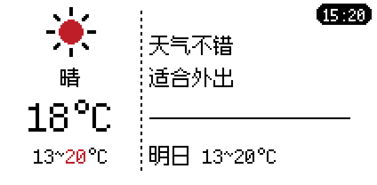
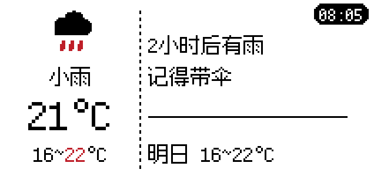
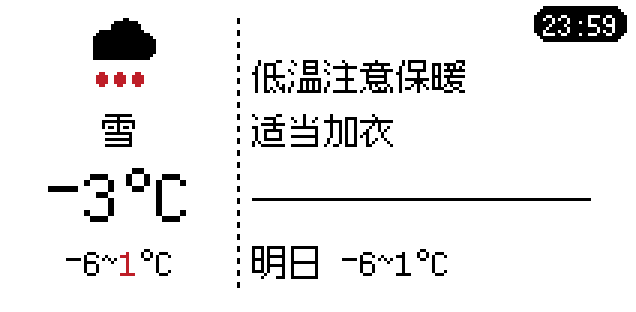
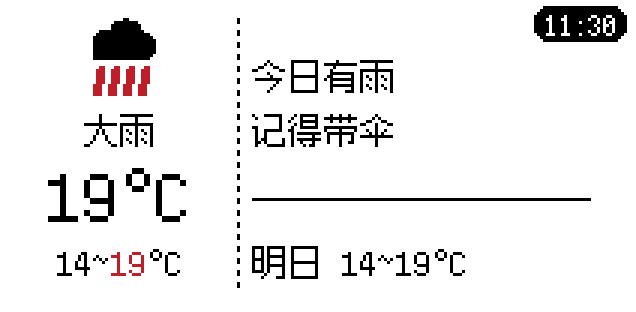
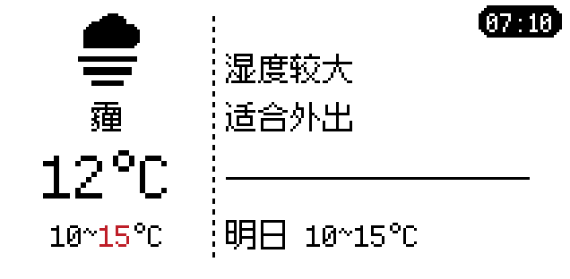

# 屏幕显示改版 v4 —— 双栏「数据 + 中文建议」

## 改了什么

**旧布局的问题**（你的原话：字号太小、文字堆叠、阅读效率低）：
原来一屏塞了 4 行英文字段（温度/体感/湿度/UV/今日高低温/明日预告），
全部 8×13 像素小字，而且中文根本显示不出来（字库只有 ASCII）。

**新布局**：按内容分区，不是简单对半分。



```
┌────────────────┬─────────────────────────────┐
│                │  紫外线强                    │  ← 第 1 行：最要紧的提醒
│    ☀ 图标      │  注意防晒                    │  ← 第 2 行：配套动作
│                │  ─────────────────          │
│   UV7          │  明日 18~27                  │  ← 明日预告
│   2 6          │                              │
└────────────────┴─────────────────────────────┘
  左栏 0–79px        右栏 84–211px
```

### 分栏依据（不是随便对半）

左栏宽度由**内容实际宽度**决定：

| 元素 | 宽度 |
|---|---|
| 图标 | 36px |
| UV 文字（"UV7"） | 36px |
| 温度放大 2 倍（"26"） | 48px |
| 左右边距 | 8px |
| → **左栏定宽** | **80px** |

右栏 = 212 − 80 = **132px**，按 12px 字宽可放 **11 个汉字**，实际限 10 个留余量。

如果温度是三位数（如 `-10`），左栏仍是 80px——因为温度是居中偏左绘制，
3 个字符 = 72px 刚好不溢出。

### 字体：方舟像素 12px

你要的字体，已从官方仓库取到（OFL-1.1 开源）：

- 来源：`TakWolf/ark-pixel-font` release `2026.10.25`，`12px-monospaced-zh_hans`
- **是真正的点阵字体**，12px 渲染出来是硬边像素，无抗锯齿——非常适合墨水屏
- 英文、数字、中文**同一套字体**，视觉统一

> ⚠️ 但你本机**没装**这个字体（`C:\Windows\Fonts` 里没有）。
> 这不影响使用：ESP32 根本读不到系统字体，必须**预先把字形点阵化烧进固件**。
> 我已经做好了这一步，字体文件随仓库放在 `assets/ark12/`。

### 字号对比

| | 旧 | 新 |
|---|---|---|
| 正文 | 8×13 像素（约 8px） | **12×12 像素** |
| 温度 | 8×13 × 2 倍（16px 宽） | **12×12 × 2 倍（24px）** |
| 中文 | ❌ 显示方框 | ✅ 正常显示 |
| 每屏信息 | 6 个字段挤 4 行 | **2 句建议 + 1 组数据** |

---

## 中文怎么显示出来的

这是本次最关键的技术点，说明一下原理：

```
PC 端 (Python/网页)              ESP32 固件
─────────────────                ─────────────
advice.py 决定要说什么话
        ↓
gen_font.py 读同一份字表
用 Pillow 把每个字渲染成 12×12 点阵
        ↓
font_zh12.h (134 个字, 3.2 KB)
        ↓ 烧录进固件
                                 渲染时按 Unicode 码位查表
                                 → 逐点亮墨水屏
```

**关键设计：字表只包含程序真正会说的话。**

`advice.py` 里的短语模板就是唯一的真相来源，
`gen_font.py` 直接 import 它来生成字库。
所以**生成的字库和程序说的话永远不会脱节**，不会出现方框。

134 个字（含 26 个英文字母 + 10 个数字 + 常用标点）总共只占 **3.2 KB**。

---

## 中文建议是怎么算出来的

`service/advice.py` 的优先级逻辑（第 1 行最重要）：

| 条件 | 第 1 行 | 第 2 行 |
|---|---|---|
| 1–9 小时后有雨 | `N小时后有雨` | `记得带伞` |
| 正在下雨 | `即将下雨` | `记得带伞` |
| UV ≥ 8 | `紫外线很强` | `注意防晒` |
| UV ≥ 6 | `紫外线强` | `注意防晒` |
| 最高温 ≥ 33 | `高温注意补水` | `注意补水` |
| 最低温 ≤ 2 | `低温注意保暖` | `适当加衣` |
| 风速 ≥ 30 | `风力较大` | `注意防风` |
| 湿度 ≥ 85 | `湿度较大` | `适合外出` |
| 湿度 ≤ 25 | `空气干燥` | `适合外出` |
| 其他 | `天气不错` | `适合外出` |

「几小时后有雨」的判定：查 Open-Meteo 的 `hourly` 数据，
从当前小时起往后看 9 小时，命中降雨代码**或**降水概率 ≥60% 就报警。

预演效果：





---

## 协议变更（新增字段）

```json
{
  "temp": 26, "uv": 7, "code": 113, "epoch": 1730544000,
  "a1": "紫外线强",
  "a2": "注意防晒"
}
```

| 字段 | 说明 |
|---|---|
| `a1` | 右栏第 1 行中文（≤10 字） |
| `a2` | 右栏第 2 行中文（≤10 字） |
| `a3` | 保留（当前布局只显示 2 行） |

固件收到 `a1`/`a2` 会存进 NVS，断电重启也还在。

---

## 自己改文案

想加句子，只要改 `service/advice.py` 的 `PHRASES`，然后：

```powershell
cd F:\AIchat\epd_ble\service
.\.venv\Scripts\python.exe gen_font.py          # 重新生成字库
.\.venv\Scripts\python.exe preview_scene.py     # 预览效果
# 把 service\font_zh12.h 复制到工程目录
cd F:\AIchat\epd_ble\service
Copy-Item font_zh12.h "F:\industryworks\arduino\ESP32-S3-LCD-2-Demo\Arduino\examples\20_epd_weather_station\" -Force
```

然后重新烧录固件。**不用手动维护字表**——脚本会自己算出需要哪些字。

---

## 预览工具

没有硬件也能看效果：

```powershell
cd F:\AIchat\epd_ble\service
.\.venv\Scripts\python.exe preview_scene.py      # 生成 preview_scene.png
.\.venv\Scripts\python.exe preview_font.py "紫外线强" "注意防晒"   # 字库 ASCII 预览
```

`preview_scene.py` 用 Python 复刻了固件的绘制逻辑（同样的坐标、同样的字库），
所以**看到的就是屏幕上的样子**。

---

## 修订 v5（2026-11-01 修复实机问题）

实机刷入 v4 后暴露三个问题，均已修复：

### 1. 「即」字显示成方框

`即将下雨` 里的 **即**（U+5373）在方舟像素 12px 的 `zh_hans` 子集里**是缺字**，
字体给的是「空心方框」字形，上屏就是一堆方块。

- 修法：文案改成 **`正在下雨`**，绕开该码位
- 加固：新增 `service/check_tofu.py`，生成字库后自动扫描「缺字方框」，
  测试里也加了「文案不许含『即』」的回归断言

```powershell
.\.venv\Scripts\python.exe check_tofu.py
```

### 2. 「明日」重复两次

`20_epd_weather_station.ino` 和 `epd_layout.cpp` **各加了一次「明日」前缀**，
拼出来变成 `明日 明日 13~20`。

- 修法：只在固件里拼一次完整字符串，布局层不再加前缀

### 3. 英文字符被拉散（`U V 7`）

之前所有字符都按 12px 定宽推进，但方舟像素是**等宽半角**：ASCII 只占 6px。

- 修法：字库每一项新增 `w` 字段（ASCII=6 / CJK=12），绘制时按实际字宽推进
- 顺带修好了 `UV7` 之类英文串的观感

### 4. 补齐摄氏度符号

- 大温度：`26°C`（24px，`°` 与 `C` 随温度一起放大）
- 明日预告：`明日 13~20°C`

### 5. 左栏留白 + 对齐

- 图标、UV、温度**统一按左栏中心 x=40 居中**，不再各自贴左边
- 温度用 24px（12px×2 整数倍放大，像素边缘依然锐利）
- 左下角温度与右下角明日预告**底部视觉对齐**（温度 y=72，预告 y=84）


### 6. 附带修复：断开后不再广播（重要）

实机测试发现：**连上一次并写完天气后，设备就不再广播了**，主机再也搜不到，
表现为「连接失败」。

根因是 arduino-esp32 3.3.x 的 `startAdvertising()` 在断开连接后**偶发静默失败**
（函数返回成功，但实际没在广播）。

- 修法：`eink_weather.cpp` 加**广播看门狗**——未连接时每 5 秒无条件补一次
  `startAdvertising()`（已在广播时该调用幂等，无副作用）

> ⚠️ 这个 bug 会让设备"假死"（不广播但仍通电）。
> 修复前中招的设备需**断电重启一次**才能恢复；刷入新版固件后不会再出现。
---

## 修订 v6（2026-11-02 微调：更新时间 + 温度区间）

### 1. 右上角「最新更新时间」

黑底圆角矩形 + **阴刻**（挖白字），比正文小一档：

- 字号 **10px**（新增 `font_time10.h`，仅 11 个字：0-9 与冒号，220 字节）
- 格式 `HH:MM` 24 小时制，5 字符仅占 **25px 宽**
- 圆角半径 3px，采用像素风 45° 切角（2~3px 尺度与真圆无差别，还省 flash）
- 位置 `x = 212 - 宽 - 3`，`y = 2`

> 为什么小字要用黑底反白：三色 EPD 上 10px 的黑字笔画太细，
> 换成黑底挖白字后对比更强，实际可读性更好。

### 2. 左下角补「今日温度区间」

- 当前温度仍 **24px**（12px×2），下方紧跟 **12px** 区间 `13~20°C`
- **最高温单独染红**（`20` 用 color=2），低位与单位保持黑色
- 实现上把区间拆成三段分别绘制：`13~`(黑) / `20`(红) / `°C`(黑)

### 3. 垂直节奏重排

| y | 左栏 | 右栏 |
|---|---|---|
| 2 | — | 更新时间胶囊（12px 高） |
| 18 | 天气图标中心 | — |
| 20 | — | 建议第 1 行 |
| 38 | 紫外线 | 建议第 2 行 |
| 54 | 温度 24px | — |
| 66 | — | 分隔线 |
| 82 | 温度区间 12px | 明日预告 |

底行左右对齐（都在 y=82），视觉上收得住。

### 4. 预览工具升级

`tools/preview_scene.py` 改为 RGB 输出，能正确显示红色；
同时支持加载两套字库、复刻圆角矩形，做到「预览即所见」。

```powershell
python tools/preview_scene.py    # 一次渲染 3 个场景
```


---

## 修订 v7（2026-11-02 图标重做：SVG 双色面性 + 雨分两档 + 天气文字）

### 1. 图标改成 SVG 制作的双色面性风格

原来的天气图标是用 `drawCircle/drawLine` 现画的几何图形，线条细、辨识度一般。
现在改成 **SVG 设计 → 本地渲染 → 点阵化** 的流程：

```
assets/icons/*.svg  (30x30，黑 #000 + 红 #E00000)
        ↓  tools/gen_icons.py
   ① 内联进 HTML
   ② Chrome headless 渲染成 300x300 PNG（10 倍，抗锯齿）
   ③ 按 10x10 块采样回 30x30，分「黑/红/空」三态
        ↓
firmware/…/icons.h  (8 个图标，1.9 KB)
```


好处：**改图标不用抠像素**，直接改 SVG 重跑脚本即可。

### 2. 雨分两档（小雨 / 大雨）

| 档位 | 图标 | 覆盖的 wttr.in 代码 |
|---|---|---|
| 小雨 | 黑云 + 3 条短细雨滴 | 176 182 185 263 266 293 296 311 314 317 320 353 362 365 |
| 大雨 | 黑云 + 4 条长粗雨滴 | 299 302 305 308 350 356 359 374 377 |

中雨/大阵雨/冰雹归入"大雨"档；其余降雨归"小雨"档。

### 3. UV 数字去掉，改显示天气文字

左栏原来那行 `UV4` 换成当前天气的中文标签（`晴 / 多云 / 阴 / 霾 / 小雨 / 大雨 / 雪 / 雷阵雨`）。

- **理由**：UV 等级已经在右侧建议里体现（"紫外线强 / 注意防晒"），
  再单独占一行数字是重复信息；换成天气文字信息增量更大。
- 标签与图标 id 一一对应（`ICON_LABEL[8]`），只有 8 种，整齐可控。

> ⚠️ **fog 显示"霾"不是"雾"** —— 方舟像素 12px 的 zh_hans 子集里
> 「雾」(U+96FE) 是缺字方框（和「即」同类问题），实测「霾」可用。
> 这类坑统一由 `tools/check_tofu.py` 兜底检查。

### 4. 布局微调

| y | 左栏 | 右栏 |
|---|---|---|
| 2 | — | 更新时间胶囊 |
| 18 | **双色图标（30x30）** | — |
| 38 | **天气文字（晴/小雨…）** | 建议第 2 行 |
| 54 | 温度 24px | — |
| 66 | — | 分隔线 |
| 82 | 温度区间 12px | 明日预告 |

### 5. 效果

| 晴 | 小雨 | 大雨 |
|---|---|---|
|  |  |  |

| 雪（零下） | 雾（霾） |
|---|---|
|  |  |